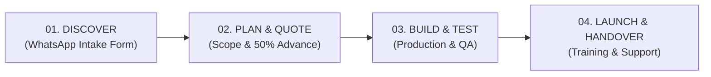

# Matrix Studio — Master Agency Playbook & Delivery SOP

> **Operational Blueprint:** This playbook defines the exact 6 Services mapped to 6 high-demand Pakistani business industries. When a client inquiry or paid order arrives via WhatsApp, use this checklist to execute and deliver without guesswork.

---

## 1. The 6x6 Strategic Industry & Service Matrix

| # | Service Category | Targeted Industry (Pakistan) | High-Pain Problem Solved | Core Deliverables |
| :-: | :--- | :--- | :--- | :--- |
| **01** | **Digital Presence** | **Restaurants & Cafés** (Burgers, Cafes, Biryani, Chai dhabas) | Paper menus are expensive to reprint, customers hate waiting for waiters, no Google presence. | • Mobile-first QR Smart Menu • Fast 1-Page Ordering Website • Google Maps & Business Profile Optimization |
| **02** | **AI & Automation** | **Medical & Dental Clinics** (Dentists, Dermatologists, General Clinics) | Front desk is flooded with phone calls asking for doctor timings, appointment slots, and fees. | • 24/7 WhatsApp Smart Appointment Bot • Instant Roman Urdu/English FAQ Assistant • Automated WhatsApp Appointment Reminders |
| **03** | **Creative Branding** | **Luxury Retail & Perfumes** (Attar, Fragrances, Watches, Jewelry) | Ordinary products look cheap on Instagram and cannot charge premium prices. | • High-End Vector Logo & Brand Guide • Studio-Graded Commercial Product Shoots (AI-Assisted) • 4:5 Meta Ad Posters & Packaging Mockups |
| **04** | **Digital Marketing** | **Clothing & Fashion Retail** (Pret, Kurti, Abaya, Men's Kurta, Footwear) | Low engagement on static photos, high ad costs, poor local footfall in shopping malls/bazaars. | • AI-Assisted High-Energy Video Reels • Hyper-Local Meta Ad Campaigns (Karachi radius) • Conversion Offer Graphics ("Flat 30% Off") |
| **05** | **Business Management** | **E-Commerce & Wholesale SMBs** (Online Sellers, Distribution, Traders) | Stock running out, lost customer contact numbers, messy WhatsApp chats, manual notebook accounting. | • Lightweight WhatsApp Lead Tracker CRM • Google Sheets Real-Time Inventory Tracker • Automated Sales & Daily Profit Dashboard |
| **06** | **Growth Solutions** | **Salons, Spas & Beauty Parlors** (Bridal Studios, Hair Salons, Aesthetic Spas) | Clients come once for wedding/eid and never return; zero Google reviews despite good service. | • WhatsApp Loyalty Card & Points Program • Automated 5-Star Google Review Trigger Workflow • Automated Re-engagement (30-day Hair/Facial reminder) |

---

## 2. Universal 4-Step Client Delivery SOP

### Phase 1: Discover (Intake via WhatsApp)
1. When a client messages via the website or WhatsApp:
   - Acknowledge within 5 minutes: *"Salam [Name]! Matrix Studio mein khush-amdeed. Aapke business ki details mil gayin."*
   - Ask for:
     - High-res logo (if they have one; if not, upsell Service 03).
     - Raw menu / price list / doctor schedule (photo or PDF).
     - Exact branch address & Google Maps link.
     - Brand colors or competitor pages they admire.

### Phase 2: Plan & Quote
1. Send a 1-page structured quotation on WhatsApp:
   - **Scope:** Exactly what is included (e.g., 1x QR Menu + 1x WhatsApp counter flow + 3 table acrylic QR stands).
   - **Timeline:** Delivery in 5–7 working days.
   - **Commercials:** 50% Advance via Bank Transfer / Raast / Nayapay, 50% upon final delivery.

### Phase 3: Build & Quality Check
1. Develop using Matrix Studio templates:
   - Visuals: 4:5 ratio for Meta, 9:16 for Reels/Stories, 16:9 for Web headers.
   - WhatsApp Bot: Test all Roman Urdu variations ("menu", "khana", "timing", "kahan ho", "rate").
   - Test on mobile screens (iPhone Safari and Android Chrome).

### Phase 4: Launch & Handover
1. Send final link or deliverables with a 2-minute Loom/WhatsApp screen recording explaining how to use it.
2. Provide a 14-day warranty for minor text/price adjustments.
3. Request a Google / WhatsApp review.

---

## 3. Service-by-Service Execution Blueprints

### Blueprint 01: Restaurant QR Smart Menu & Web Presence
- **Tool Stack:** HTML5 / Tailwind CSS (lightweight single-page) + Cloudflare Pages or Netlify.
- **Turnaround:** 3 to 5 days.
- **Workflow:**
  1. Categorize menu into maximum 6 sections (Burgers, Deals, Sides, Drinks, Desserts).
  2. Use clean, high-contrast typography with clear PKR prices.
  3. Table QR Code generation linking to `https://clientbrand.pk/menu`.
  4. WhatsApp Direct Order Button: *"Order via WhatsApp"* pre-fills selected items.

### Blueprint 02: Healthcare & Clinic 24/7 WhatsApp Assistant
- **Tool Stack:** WhatsApp Business App Quick Replies / Automated Webhook / Twilio / ManyChat.
- **Turnaround:** 4 to 7 days.
- **Workflow:**
  1. Setup greeting message with Doctor name, qualification, and PMDC number.
  2. Main Menu:
     - `1` Consultation Timings & Days
     - `2` Book an Appointment (collects Patient Name, Phone, Age, Preferred Time)
     - `3` Clinic Location & Google Maps
     - `4` Consultation Fees
  3. Automated Notification forwarded to reception desk phone.

### Blueprint 03: Luxury Retail & Perfume Creative Campaign
- **Tool Stack:** Midjourney / Flux (for background environment) + Photoshop (for realistic product placement & reflections) + Figma (typography & badges).
- **Turnaround:** 3 to 5 days.
- **Workflow:**
  1. Client sends clear phone photo of bottle/box on plain white paper.
  2. Generate luxury contextual backdrop (wet black marble, warm sunlight, velvet drape, desert dunes).
  3. Composite actual bottle, match shadows, highlights, and amber liquid transparency.
  4. Add luxury editorial typography (*Playfair Display* / *Manrope*), bottle notes, and order CTA badge.

### Blueprint 04: Clothing & Fashion Reels & Meta Ad Campaign
- **Tool Stack:** CapCut Pro / Runway / Premiere Pro + Meta Ads Manager.
- **Turnaround:** 4 to 6 days.
- **Workflow:**
  1. Create 3 distinct creative angles:
     - Angle 1: Fabric quality & stitching close-up (Texture focus).
     - Angle 2: Full outfit aesthetic model reel with trending background audio.
     - Angle 3: Direct discount / Eid / Weekend deal ("Save Rs. 1,000 on 2 Pieces").
  2. Target hyper-local Karachi audiences (Clifton, DHA, Gulshan, PECHS) with WhatsApp CTA.

### Blueprint 05: Inventory & Sales Performance Google Sheets Automation
- **Tool Stack:** Google Sheets + Google Apps Script + WhatsApp Form Webhook.
- **Turnaround:** 3 to 5 days.
- **Workflow:**
  1. Sheet 1: Master Product List (Item Name, SKU, Cost Price, Sale Price, Current Stock).
  2. Sheet 2: Daily Sales Entry (Date, Item, Quantity, Payment Method, Delivery Status).
  3. Sheet 3: Visual Dashboard with KPI cards:
     - Today's Total Revenue
     - Low Stock Warning (items < 5 units highlighted red)
     - Monthly Net Profit Margin.

### Blueprint 06: Salon & Beauty Client Retention Workflow
- **Tool Stack:** WhatsApp Business Broadcast / Scheduled Reminder Flows.
- **Turnaround:** 2 to 4 days.
- **Workflow:**
  1. Customer completes service (Haircut, Facial, Mani-Pedi).
  2. Same Evening: Automated Thank-You message with Google Review link.
  3. Day 25: Automated courtesy reminder: *"Salam [Name]! Aapka haircut/facial 3-4 weeks pehle hua tha. Weekend booking ke liye abhi slot reserve karein."*
  4. Birthday / Anniversary perk message with 15% discount code.

---

## 4. Next Step: Building the 6 Portfolio Showcase Pieces

To attract real clients, create 1 flagship concept showcase for each of these 6 pairs:

1. **Food:** *Flame & Crust* (Smashed Burgers & Pizza) — [Already Built in Portfolio]
2. **Luxury:** *Oud Royal* (Premium Amber Perfume) — [Already Built in Portfolio]
3. **Clinic:** *Al Noor / Pearl Smile Clinic* — [Already Built in Portfolio]
4. **Fashion Retail:** *Rivaaj Pret / Streetwear Studio* — [Ready to design next]
5. **E-Commerce Ops:** *SwiftCart Karachi* (Automated Sheets & Dashboard) — [Ready to design next]
6. **Beauty Salon:** *Bella's Salon & Spa* (Loyalty & WhatsApp Flow) — [Ready to design next]
